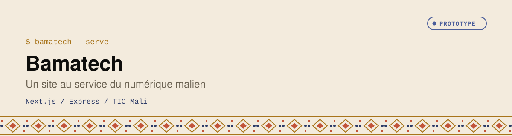

<div align="center">
  <picture>
    <source media="(prefers-color-scheme: dark)" srcset="assets/banner-dark.svg">
    
  </picture>
</div>


Plateforme numérique malienne qui connecte les acteurs, les ressources et les services TIC. Le projet a été migré vers une architecture moderne **Next.js + Express.js** pour offrir un rendu dynamique et une base extensible pour de futures intégrations (authentification, base de données, analytics, etc.).

## Architecture

```
.
├── backend/      # API Express (données simulées)
├── frontend/     # Application Next.js (SSR + interactions client)
├── CSS/, JS/, pages/  # Anciennes sources statiques conservées à titre de référence
└── README.md
```

### Backend (Express.js)
- Endpoints RESTful exposant les actualités, acteurs, ressources, formations, services et statistiques.
- Routes administrateur dédiées pour les métriques, messages entrants et utilisateurs.
- Middleware `cors`, `express.json` et `morgan` pour un développement confortable.

### Frontend (Next.js)
- Pages React (`/` et `/dashboard`) rendues côté serveur avec `getServerSideProps`.
- Récupération des données via l'API Express avec repli local en cas d'API indisponible.
- Interface riche : carrousel dynamique, mode sombre, barre de progression, recherche filtrant les acteurs, sections administrateur interactives.
- Styles modernisés et responsives conservant l'identité visuelle initiale.

## Prérequis
- Node.js 18+
- npm 9+

## Installation

```bash
# Installer les dépendances backend
cd backend
npm install

# Installer les dépendances frontend
cd ../frontend
npm install
```

## Lancer l'environnement de développement

Dans deux terminaux distincts :

```bash
# Terminal 1 - API Express
cd backend
npm run dev   # démarre sur http://localhost:4000

# Terminal 2 - Frontend Next.js
cd frontend
npm run dev   # démarre sur http://localhost:3000
```

Le frontend consomme l'API via la variable `NEXT_PUBLIC_API_BASE_URL` (défaut `http://localhost:4000/api`). Vous pouvez la personnaliser dans un fichier `.env.local` à la racine de `frontend/`.

## Endpoints API principaux

| Méthode | Route                        | Description                                      |
|---------|------------------------------|--------------------------------------------------|
| GET     | `/api/health`                | Vérification de statut                           |
| GET     | `/api/news`                  | Liste des actualités                             |
| GET     | `/api/actors`                | Annuaire des acteurs                             |
| GET     | `/api/resources`             | Ressources stratégiques                          |
| GET     | `/api/trainings`             | Sessions de formation                            |
| GET     | `/api/services`              | Services d'accompagnement                        |
| GET     | `/api/kpi`                   | Indicateurs clés de performance                  |
| GET     | `/api/dashboard/metrics`     | Statistiques pour le tableau de bord admin       |
| GET     | `/api/dashboard/messages`    | Messages entrants                                |
| GET     | `/api/dashboard/users`       | Liste des utilisateurs administrateurs           |

## Tests & qualité

Aucun outil de tests automatisés n'est encore fourni. Ajoutez vos suites Jest/Playwright ou vos workflows CI selon vos besoins.

## Prochaines étapes suggérées
- Brancher une base de données (PostgreSQL, Supabase, MongoDB…)
- Ajouter l'authentification et la gestion des rôles sur le tableau de bord
- Déployer l'API (Railway, Render, Fly.io…) et le frontend (Vercel, Netlify)
- Mettre en place un design system partagé et des tests end-to-end

Bon développement avec Bamatech !
